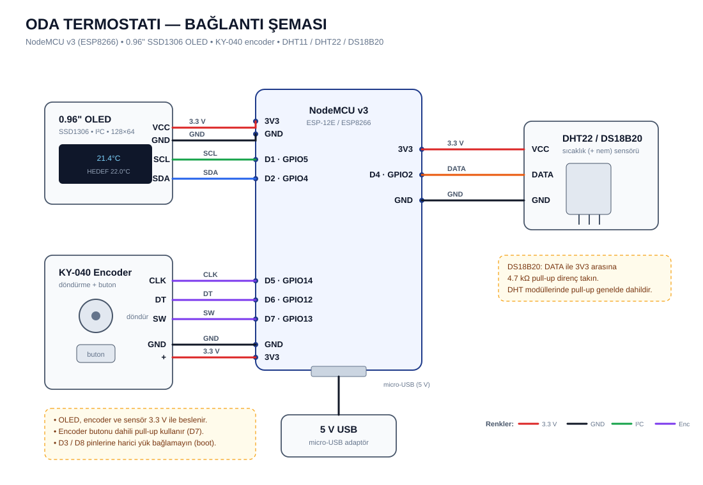

<div align="center">
  
</div>

<h1 align="center">KombiPlus</h1>

<p align="center">
  <strong>ガス給湯暖房機（コンビボイラー）向け、2 台構成の Wi-Fi ルームサーモスタット。</strong><br>
  NodeMCU v3 (ESP8266) · OLED · ロータリーエンコーダ · 組み込み Web UI · MQTT · Telegram · フェイルセーフリレー
</p>

<p align="center">
  
  
  
  
  
</p>

<p align="center">
  <strong>言語:</strong>
  <a href="README.md">English</a> ·
  <a href="README.tr.md">Türkçe</a> ·
  <a href="README.ru.md">Русский</a> ·
  <a href="README.es.md">Español</a> ·
  <a href="README.pt.md">Português</a> ·
  <a href="README.ja.md">日本語</a> ·
  <a href="README.ko.md">한국어</a> ·
  <a href="README.zh.md">中文</a>
</p>

---

**目次:** [動作の仕組み](#動作の仕組み) · [画面](#画面) · [機能](#機能) · [ハードウェア](#ハードウェア) · [リポジトリ構成](#リポジトリ構成) · [クイックスタート](#クイックスタート) · [制御ロジック](#制御ロジック) · [フェイルセーフ](#フェイルセーフリレー) · [プロトコル](#プロトコル) · [Web API](#web-api) · [MQTT と Telegram](#mqtt-と-telegram) · [保存領域とテーマ](#保存領域と-oled-テーマ) · [安全上の注意](#安全上の注意) · [バージョン](#バージョン)

---

## 動作の仕組み

```
┌─────────────────────────┐        Wi-Fi AP (KombiPlus)        ┌──────────────────────┐
│  室内ユニット            │◄─────────────────────────────────────►│  ボイラーリレーユニット │
│  NodeMCU v3             │   TCP 8266: SET heat=0/1 sp=...      │  NodeMCU v3 + リレー  │
│  DHT11/22 または DS18B20 │◄──────────────────────────────────────│  オプション DS18B20   │
│  OLED + エンコーダ + Web │        STATUS relay=... flow=...     │  COM/NO → ボイラー    │
└───────────┬─────────────┘                                      └──────────┬───────────┘
            │                                                               │
   スマホ / PC (http://192.168.4.1)                              ボイラーのサーモ端子
   自宅 Wi-Fi へ接続も可能 (STA)                                  (無電圧接点・低電圧)
```

- 室内ユニットは**常に**独自の Wi-Fi アクセスポイントを立てます。スマホを接続して
  `192.168.4.1` を開くだけ。アプリ・クラウド・アカウントは不要です。
- 自宅 Wi-Fi (STA) にも同時接続できます。リレーユニットが AP に依存するため、AP は切断されません。
- 室内ユニットは温度・設定値・ヒステリシスから熱需要を計算し、2 秒ごとにリレーユニットへ送信します。
- リレーユニットは需要に従い、**5 分間**コマンドが届かない場合は設定されたフェイルセーフ動作に移ります。
- 防水 DS18B20（オプション）がボイラーの水温を室内ユニットへ返します。
- **おやすみモード**、**凍結防止**、**ブースト**、**10 種類の OLED テーマ**、**1 時間ごとの履歴**、
  **LittleFS ファイルマネージャー**、**OTA** を標準搭載しています。

<p align="center">
  
</p>

---

## 画面

<table>
<tr>
<td width="50%"></td>
<td width="50%"></td>
</tr>
<tr>
<td align="center"><sub>10 テーマ × 5 ページ。ファームウェアと同じ描画コード</sub></td>
<td align="center"><sub><code>web_ui.h</code> から配信される実際の Web UI</sub></td>
</tr>
</table>

どちらもハードウェア不要のデモの画面です。**[`demo/demo.html`](demo/demo.html)** を
ダブルクリックすると、ブラウザ内のモック API で動作します。

---

## 機能

### 室内ユニット (`oda_termostati/`)

- **センサー選択:** DHT11 / DHT22 / DS18B20 を 1 つの `#define` で切り替え
- **0.96" SSD1306 OLED**（128×64、I²C）: 温度・設定値・状態・ネットワーク・情報ページ
- **KY‑040 ロータリーエンコーダ:** 回して設定値、短押しでページ、長押しでモード
- **10 種類の OLED テーマ** — LittleFS 上の `/themes/*.txt` を編集可能
- **8 言語の UI** — 英語・トルコ語・ロシア語・スペイン語・ポルトガル語・日本語・韓国語・中国語。
  初回起動時に言語を選択（OLED: 回して選択、押して確定／Web: 全画面ピッカー）し、`lang=` として
  保存します。OLED は ASCII フォントのため en/tr/es/pt のみ対応し、他言語は英語表示になります。
- **モバイル向け Web UI:** 設定値、モード、ブースト、おやすみ、リレー動作、MQTT/Telegram、
  履歴グラフ、ヒステリシス、校正、凍結防止、**Wi-Fi ネットワークスキャン**、システム情報
- **おやすみモード:** 指定時間帯に別の設定値（NTP 時刻）
- **MQTT:** 保持付きステータス JSON + `key=value` コマンド
- **Telegram ボット:** 状態確認と操作（設定したチャットのみ）
- **LittleFS:** 設定 `/config.txt`、1 時間ごとの履歴 `/history.csv`、`/fs` ファイルマネージャー
- **ヒステリシス + 最小 ON/OFF 時間**で短周期運転を防止
- **ブースト:** 5/15/30 分間、目標を +1.5 °C
- **凍結防止:** モード OFF でも 5 °C 未満で加熱要求
- **フェイルセーフ:** センサー異常やリレー切断時は需要を停止
- **OTA**（STA 接続時のみ）と mDNS: `http://termostat.local`

### リレーユニット (`kombi_rolesi/`)

- 室内ユニットのアクセスポイントへ自動接続
- フォトカプラ絶縁リレーモジュールでボイラーの**無電圧接点**を駆動
- **アクティブロー / アクティブハイ**を 1 行で選択
- **フェイルセーフ:** 5 分間コマンドが無ければリレー開放（既定）または最後の需要を保持
- 設定は室内ユニットから (`fs=0/1`) 届き、EEPROM に保存
- 電源投入時は**必ずリレー開放**で起動
- オプションの DS18B20 で水温を送信
- 基板 LED によるリンク表示、115200 の詳細ログ

---

## ハードウェア

| 数量 | 部品 |
|-----:|------|
| 2 | NodeMCU v3 / ESP8266 (Lolin) |
| 1 | 0.96" SSD1306 OLED、I²C、128×64 |
| 1 | KY‑040 ロータリーエンコーダ |
| 1 | DHT11 / DHT22 / DS18B20（DS18B20 は 4.7 kΩ 付き） |
| 1 | フォトカプラ絶縁 5 V リレーモジュール（1 チャンネル） |
| 1 | 防水 DS18B20（オプション、ボイラー水温） |
| 2 | 5 V USB アダプター、ジャンパー、端子台 |

<table>
<tr>
<td width="50%"></td>
<td width="50%"></td>
</tr>
<tr>
<td align="center"><sub>室内ユニット — OLED・エンコーダ・センサー</sub></td>
<td align="center"><sub>リレーユニット — ボイラーの無電圧接点</sub></td>
</tr>
</table>

| 室内ユニット | GPIO | 接続先 |
|--------------|------|--------|
| D5 | GPIO14 | OLED SCL |
| D6 | GPIO12 | OLED SDA |
| D4 | GPIO2 | センサー DATA（DHT または DS18B20） |
| D1 | GPIO5 | エンコーダ CLK |
| D2 | GPIO4 | エンコーダ DT |
| D7 | GPIO13 | エンコーダ SW（ボタン） |

| リレーユニット | GPIO | 接続先 |
|----------------|------|--------|
| D1 | GPIO5 | リレー IN |
| VIN | — | リレー VCC (5 V) |
| GND | — | リレー GND |
| D2 | GPIO4 | DS18B20 DATA（オプション） |

ピン表・注意事項・トラブルシューティングは
[`oda_termostati/README.md`](oda_termostati/README.md) と [`kombi_rolesi/README.md`](kombi_rolesi/README.md) にあります。

---

## リポジトリ構成

```
kombi/
├── README.md                  ← 英語（メイン）+ 7 言語の翻訳
├── CHANGELOG.md               ← リリース履歴
├── LICENSE                    ← MIT
├── oda_termostati/
│   ├── oda_termostati.ino     ← 室内ユニットのファームウェア
│   ├── web_ui.h               ← 組み込み HTML/CSS/JS
│   ├── src/LittleFSExplorer/  ← 同梱ファイルマネージャー (MIT)
│   ├── src/OledTheme/         ← OLED テーマエンジン（10 テーマ）
│   └── README.md
├── kombi_rolesi/
│   ├── kombi_rolesi.ino       ← リレーユニットのファームウェア
│   └── README.md
├── demo/
│   ├── demo.html              ← ハードウェア不要の UI デモ
│   ├── demo.src.html          ← デモのテンプレート
│   ├── web_ui_demo.html       ← 生成された Web UI 単体ページ
│   └── build_demo.ps1         ← web_ui.h からデモを再生成
└── docs/
    ├── images/                ← バナー、スクリーンショット
    └── *.svg                  ← 配線図と構成図
```

---

## クイックスタート

### 1. Arduino 環境

1. **Arduino IDE 2.x** → *Preferences* → *Additional boards manager URLs*:

   ```
   https://arduino.esp8266.com/stable/package_esp8266com_index.json
   ```

2. *Boards Manager* → **esp8266** `3.1.2` をインストール。
3. *Library Manager* → 以下をインストール:

   `Adafruit SSD1306`、`Adafruit GFX Library`、`DHT sensor library`、
   `Adafruit Unified Sensor`、`OneWire`、`DallasTemperature`、`PubSubClient`。

   `LittleFSExplorer` とテーマエンジンは `oda_termostati/src/` に**同梱**済みです。

4. ボード: **NodeMCU 1.0 (ESP‑12E Module)**、書き込み速度 **115200**、Flash 4 MB。

### 2. 設定

**両方のスケッチで同じ AP 情報を使用してください:**

```cpp
// oda_termostati.ino
#define AP_SSID  "KombiPlus"
#define AP_PASS  "Kombi.1881"

// kombi_rolesi.ino
#define TERMOSTAT_AP_SSID  "KombiPlus"
#define TERMOSTAT_AP_PASS  "Kombi.1881"
```

室内ユニットのセンサーを選択:

```cpp
#define SENSOR_TYPE  SENSOR_DHT22   // SENSOR_DHT11 / SENSOR_DHT22 / SENSOR_DS18B20
```

アクティブハイのリレーボード:

```cpp
#define RELAY_ACTIVE_LOW  0
```

### 3. 書き込みと確認

1. まず**リレーユニット**を書き込みます（ボイラーへの接点接続はまだ行わない）。
2. 次に**室内ユニット**を書き込みます。
3. `KombiPlus`（パスワード `Kombi.1881`）に接続し、`http://192.168.4.1` を開きます。
4. リレーのシリアルログに `Oda unitesine baglandi.`、Web UI に **Kombi bağlı** が出れば OK。
5. テスト後、リレー接点のボイラー接続は**有資格の技術者**に依頼してください。

---

## 制御ロジック

```
実効目標値 = モード ON  → おやすみ中はおやすみ目標値、それ以外は設定値
                          （ブースト中は +1.5 °C）
             モード OFF → 凍結防止（既定 5 °C）

加熱 ON : 温度 ≤ 目標 − ヒステリシス かつ 前回 OFF から 180 秒以上
加熱 OFF: 温度 ≥ 目標 + ヒステリシス かつ 前回 ON から 60 秒以上
```

| パラメータ | 既定値 | 範囲 |
|------------|--------|------|
| 設定値 | 21.0 °C | 5–30 °C |
| ヒステリシス | 0.3 °C | 0.1–3.0 °C |
| 最小 ON 時間 | 60 秒 | 固定 |
| 最小 OFF 時間 | 180 秒 | 固定 |
| 凍結防止 | 5.0 °C | 2–10 °C |
| ブースト | +1.5 °C | 5/15/30 分 |
| おやすみモード | オフ | 23:00–07:00、18.0 °C |
| リレー フェイルセーフ | 開放 | 開放 / 最後の需要を保持 |
| 1 時間履歴 | 720 件 | 約 30 日 |

30 秒以上更新されないセンサー値では需要を停止します。モード OFF でも凍結防止は動作します。

---

## フェイルセーフリレー

リレーは `heat=1` **かつ**最後のコマンドが 5 分以内のときだけ閉じます。

- `fs=0`**（既定）** — リレー開放、ボイラー停止。安全な選択です。
- `fs=1` — 最後の需要を保持。凍結リスクは下がりますが過熱リスクがあります。
  ボイラー側に安全サーモスタットとリミット保護がある場合**のみ**使用してください。
- 電源投入時は必ず開放で起動するため、停電復帰で勝手に加熱しません。

---

## プロトコル

室内ユニットが **TCP 8266** で待ち受け、リレーユニットがクライアントです。行単位の ASCII:

| 方向 | 行 |
|------|-----|
| 室内 → リレー | `SET heat=1 sp=21.0 hyst=0.3 mode=1 fs=0\n` |
| リレー → 室内 | `STATUS relay=1 flow=42.50 rssi=-58 up=123 fs=0 fw=1.1.0\n` |

どちらも 115200 のシリアルログで確認できます。

---

## Web API

組み込み Web サーバーがポート 80 で JSON を返します。Home Assistant、スクリプト、curl に便利です。

| メソッド | パス | 例 |
|----------|------|----|
| GET | `/api/status` | ステータス JSON 全体 |
| GET | `/api/set?sp=22.0` | 設定値 |
| GET | `/api/set?mode=0` | モード OFF |
| GET | `/api/set?hyst=0.4&cal=-0.2&frost=6` | 調整値 |
| GET | `/api/set?boost=15` | 15 分ブースト（`0` で解除） |
| GET | `/api/set?sleep=1&sleepstart=23:00&sleepend=07:00&sleepsp=18` | おやすみモード |
| GET | `/api/set?failsafe=1` | リレー: 需要を保持 |
| GET | `/api/set?theme=gece` | OLED テーマ選択 |
| GET | `/api/theme` | テーマ一覧 + 現在のテーマ |
| GET | `/api/theme?set=retro` | テーマ選択 |
| GET | `/api/theme?reload=1` | テーマファイル再読み込み |
| POST | `/api/net` | MQTT / Telegram 設定 |
| GET | `/api/history?hours=24` | 履歴データ |
| POST | `/api/history/sample` | 現在値を記録 |
| POST | `/api/history/clear` | 履歴削除 |
| GET | `/api/scan` | 周辺 Wi-Fi ネットワーク (`nets[]`) |
| POST | `/api/wifi` | `ssid`、`pass` フォーム |
| POST | `/api/reboot` | 再起動 |
| GET | `/fs` | LittleFS ファイルマネージャー |

`/api/status` のキー: `fw, theme, temp, hum, sp, eff, hyst, cal, frost, mode, demand, relay,
link, flow, brssi, boost, boostMin, sensorOk, sleepEn, sleep, sleepStart, sleepEnd, sleepSp,
failsafe, mqtt, mqttCfg, mqttPort, mqttPrefix, tg, tgOk, tgErr, tgChat, timeOk, now, hist,
fsUsed, fsTotal, uptime, ip, apip, ssid, sta, rssi, heap, client`。

---

## MQTT と Telegram

**MQTT**（Web → *MQTT & Telegram*）:

- `kombi/status` — 保持付き JSON（`temp`、`sp`、`eff`、`mode`、`demand`、`relay`、`link`、`sleep`、`failsafe`、`boost` など）
- `kombi/set` — `sp=22.5`、`mode=1`、`sleepsp=18`、`sleepstart=23:00&sleepend=07:00`、`failsafe=1`
- `kombi/result` — `ok` / エラー

**Telegram**: `/durum`、`/sicaklik 22.5`、`/mod ac|kapat`、`/boost 30`、`/uyku ac|kapat`、
`/uykusaat 23:00 07:00`、`/uykusicaklik 18`、`/yardim`。設定したチャットのみ応答します。

---

## 保存領域と OLED テーマ

- `/config.txt` — すべての設定（`key=value`）。旧 EEPROM から自動移行
- `/history.csv` — 1 時間ごとの記録: `時刻, 室温, 湿度, 設定値, 需要, おやすみ`
- `/themes/*.txt` — テーマ定義（`id, header, tempsize, separator, status, nem, boost, su,
  sayfa, etiket, ters, dim`）。無ければ初回起動時に再生成
- `/themes/active.txt` — 最後に選んだテーマ ID
- Web UI は 24 時間 / 7 日 / 30 日のグラフを描画。`/fs` で一覧・ダウンロード・アップロード・
  削除・編集が可能

内蔵テーマ: `klasik`、`ince`、`dolu`、`kutu`、`nokta`、`dijital`、`neon`、`panel`、
`minimal`、`retro`。

---

## 安全上の注意

- ガスボイラー内部には **230 V** があります。開蓋や接点配線は有資格の技術者が行ってください。
- リレーはボイラーのサーモスタット入力へ**無電圧接点**として接続します。
- **フォトカプラ絶縁**リレーモジュール、適切なヒューズ、良質な 5 V 電源を使用してください。
- 本番では AP と OTA のパスワードを変更し、ネットワークを来客に開放しないでください。
- 趣味／改善目的のプロジェクトであり、**保証はありません**。リスクは利用者が負います。
- ボイラー自身の安全サーモスタットとリミット保護は常に有効にしてください。

---

## バージョン

- **v1.1.0** — OLEDテーマ10種、室温中心のメイン画面、ブラウザからの初期設定 ([CHANGELOG.md](CHANGELOG.md))
- **v1.0.0** — 最初の安定版（[CHANGELOG.md](CHANGELOG.md)）
- 検証環境: ESP8266 Arduino core 3.1.2、Arduino IDE 2.x
- 室内ユニットの IRAM は約 95 %（必要なら `TELEGRAM_ENABLED 0` で確保）
- 変更時は両デバイスの `FW_VERSION` と AP 設定を揃えてください

---

## ライセンス

[MIT](LICENSE) — 使用・変更・共有は自由です。`LittleFSExplorer` は独自の MIT ライセンスを保持します。
