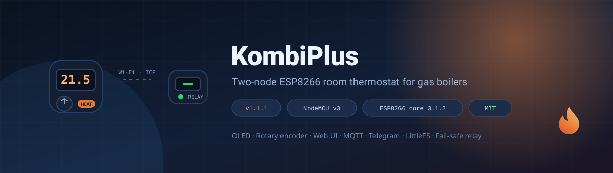
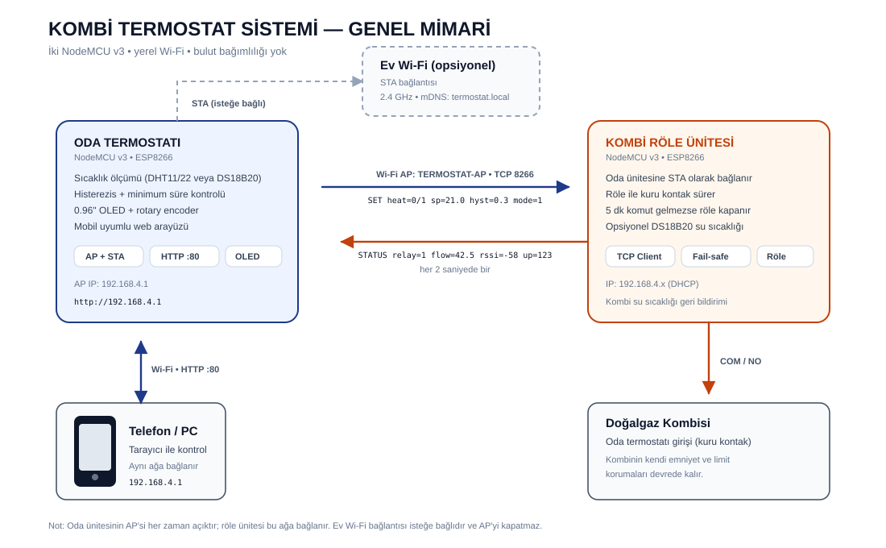

<div align="center">
  
</div>

<h1 align="center">KombiPlus</h1>

<p align="center">
  <strong>가스 보일러용 2개 구성 Wi-Fi 실내 온도조절기.</strong><br>
  NodeMCU v3 (ESP8266) · OLED · 로터리 엔코더 · 내장 웹 UI · MQTT · Telegram · 페일세이프 릴레이
</p>

<p align="center">
  
  
  
  
  
</p>

<p align="center">
  <strong>언어:</strong>
  <a href="README.md">English</a> ·
  <a href="README.tr.md">Türkçe</a> ·
  <a href="README.ru.md">Русский</a> ·
  <a href="README.es.md">Español</a> ·
  <a href="README.pt.md">Português</a> ·
  <a href="README.ja.md">日本語</a> ·
  <a href="README.ko.md">한국어</a> ·
  <a href="README.zh.md">中文</a>
</p>

---

**목차:** [동작 방식](#동작-방식) · [화면](#화면) · [기능](#기능) · [하드웨어](#하드웨어) · [저장소 구조](#저장소-구조) · [빠른 시작](#빠른-시작) · [제어 로직](#제어-로직) · [페일세이프](#페일세이프-릴레이) · [프로토콜](#프로토콜) · [Web API](#web-api) · [MQTT와 Telegram](#mqtt와-telegram) · [저장 영역과 테마](#저장-영역과-oled-테마) · [안전](#안전) · [버전](#버전)

---

## 동작 방식

```
┌─────────────────────────┐        Wi-Fi AP (KombiPlus)        ┌──────────────────────┐
│  실내 유닛               │◄─────────────────────────────────────►│  보일러 릴레이 유닛    │
│  NodeMCU v3             │   TCP 8266: SET heat=0/1 sp=...      │  NodeMCU v3 + 릴레이  │
│  DHT11/22 또는 DS18B20   │◄──────────────────────────────────────│  선택 DS18B20        │
│  OLED + 엔코더 + 웹      │        STATUS relay=... flow=...     │  COM/NO → 보일러      │
└───────────┬─────────────┘                                      └──────────┬───────────┘
            │                                                               │
   스마트폰 / PC (http://192.168.4.1)                             보일러 온도조절기 단자
   가정 Wi-Fi 연결 (STA, 선택)                                    (무전압 접점, 저전압)
```

- 실내 유닛은 **항상** 자체 Wi-Fi 액세스 포인트를 엽니다. 스마트폰을 연결해
  `192.168.4.1`만 열면 됩니다. 앱, 클라우드, 계정이 필요 없습니다.
- 원하면 가정 Wi-Fi(STA)에도 함께 연결됩니다. 릴레이 유닛이 AP에 의존하므로 AP는 꺼지지 않습니다.
- 2초마다 온도·설정값·히스테리시스로 열 수요를 계산해 릴레이 유닛으로 보냅니다.
- 릴레이 유닛은 수요를 적용하고, **5분** 동안 명령이 없으면 설정된 페일세이프 동작으로 전환합니다.
- 방수 DS18B20(선택)이 보일러 수온을 실내 유닛으로 보고합니다.
- **취침 모드**, **동파 방지**, **부스트**, **OLED 테마 10종**, **시간별 이력**,
  **LittleFS 파일 관리자**, **OTA**가 기본 포함됩니다.

<p align="center">
  
</p>

---

## 화면

<table>
<tr>
<td width="50%"></td>
<td width="50%"></td>
</tr>
<tr>
<td align="center"><sub>10가지 테마의 OLED 5개 페이지 — 펌웨어와 같은 드로잉 코드</sub></td>
<td align="center"><sub><code>web_ui.h</code>에서 제공되는 실제 웹 UI</sub></td>
</tr>
</table>

두 화면 모두 하드웨어 없이 동작하는 데모에서 캡처했습니다. **[`demo/demo.html`](demo/demo.html)** 을
두 번 클릭하면 브라우저 안의 모의 API로 실행됩니다.

---

## 기능

### 실내 유닛 (`oda_termostati/`)

- **센서 선택:** DHT11 / DHT22 / DS18B20, `#define` 한 줄로 변경
- **0.96" SSD1306 OLED** (128×64, I²C): 온도·설정값·상태·네트워크·정보 페이지
- **KY‑040 로터리 엔코더:** 돌려서 설정값, 짧게 눌러 페이지, 길게 눌러 모드
- **OLED 테마 10종** — LittleFS의 `/themes/*.txt` 파일로 편집 가능
- **8개 언어 UI** — 영어, 터키어, 러시아어, 스페인어, 포르투갈어, 일본어, 한국어, 중국어.
  첫 부팅 시 언어를 선택하며(OLED: 돌려 선택, 눌러 확인 / 웹: 전체 화면 선택), `lang=`으로
  저장됩니다. OLED는 ASCII 폰트라 en/tr/es/pt만 지원하고 나머지는 영어로 표시됩니다.
- **모바일 우선 웹 UI:** 설정값, 모드, 부스트, 취침, 릴레이 동작, MQTT/Telegram,
  이력 그래프, 히스테리시스, 보정, 동파 방지, **Wi-Fi 네트워크 검색**, 시스템 정보
- **취침 모드:** 지정 시간대에 다른 설정값 (NTP 시각)
- **MQTT:** retained 상태 JSON + `key=value` 명령
- **Telegram 봇:** 상태 확인과 제어, 지정한 채팅만 허용
- **LittleFS:** 설정 `/config.txt`, 시간별 이력 `/history.csv`, `/fs` 파일 관리자
- **히스테리시스 + 최소 ON/OFF 시간**으로 잦은 단주기 운전 방지
- **부스트:** 5/15/30분 동안 목표 +1.5 °C
- **동파 방지:** 모드 OFF에서도 5 °C 아래면 난방 요청
- **페일세이프:** 센서 오류나 릴레이 연결 끊김 시 수요 중단
- **OTA**(STA 전용)와 mDNS: `http://termostat.local`

### 릴레이 유닛 (`kombi_rolesi/`)

- 실내 유닛의 액세스 포인트에 자동 접속
- 포토커플러 절연 릴레이 모듈로 보일러의 **무전압 접점** 제어
- **액티브 로우 / 액티브 하이**를 한 줄로 선택
- **페일세이프:** 5분간 명령이 없으면 릴레이 개방(기본) 또는 마지막 수요 유지
- 설정은 실내 유닛에서 (`fs=0/1`) 전달되어 EEPROM에 저장
- 전원 인가 시 릴레이는 **항상 개방**으로 시작
- 선택형 DS18B20으로 보일러 수온 보고
- 보드 LED 링크 표시와 115200 상세 로그

---

## 하드웨어

| 수량 | 부품 |
|-----:|------|
| 2 | NodeMCU v3 / ESP8266 (Lolin) |
| 1 | 0.96" SSD1306 OLED, I²C, 128×64 |
| 1 | KY‑040 로터리 엔코더 |
| 1 | DHT11 / DHT22 / DS18B20 (DS18B20은 4.7 kΩ 포함) |
| 1 | 포토커플러 절연 5 V 릴레이 모듈 (1채널) |
| 1 | 방수 DS18B20 (선택, 보일러 수온) |
| 2 | 5 V USB 어댑터, 점퍼, 단자대 |

<table>
<tr>
<td width="50%"></td>
<td width="50%"></td>
</tr>
<tr>
<td align="center"><sub>실내 유닛 — OLED, 엔코더, 센서</sub></td>
<td align="center"><sub>릴레이 유닛 — 보일러 무전압 접점</sub></td>
</tr>
</table>

| 실내 유닛 | GPIO | 연결 |
|-----------|------|------|
| D5 | GPIO14 | OLED SCL |
| D6 | GPIO12 | OLED SDA |
| D4 | GPIO2 | 센서 DATA (DHT 또는 DS18B20) |
| D1 | GPIO5 | 엔코더 CLK |
| D2 | GPIO4 | 엔코더 DT |
| D7 | GPIO13 | 엔코더 SW (버튼) |

| 릴레이 유닛 | GPIO | 연결 |
|-------------|------|------|
| D1 | GPIO5 | 릴레이 IN |
| VIN | — | 릴레이 VCC (5 V) |
| GND | — | 공통 GND |
| D2 | GPIO4 | DS18B20 DATA (선택) |

핀 표, 주의 사항, 문제 해결은
[`oda_termostati/README.md`](oda_termostati/README.md)와 [`kombi_rolesi/README.md`](kombi_rolesi/README.md)에 있습니다.

---

## 저장소 구조

```
kombi/
├── README.md                  ← 영어(기본) + 7개 번역
├── CHANGELOG.md               ← 릴리스 기록
├── LICENSE                    ← MIT
├── oda_termostati/
│   ├── oda_termostati.ino     ← 실내 유닛 펌웨어
│   ├── web_ui.h               ← 내장 HTML/CSS/JS
│   ├── src/LittleFSExplorer/  ← 포함된 파일 관리자 (MIT)
│   ├── src/OledTheme/         ← OLED 테마 엔진 (10종)
│   └── README.md
├── kombi_rolesi/
│   ├── kombi_rolesi.ino       ← 릴레이 유닛 펌웨어
│   └── README.md
├── demo/
│   ├── demo.html              ← 하드웨어 없는 UI 데모
│   ├── demo.src.html          ← 데모 템플릿
│   ├── web_ui_demo.html       ← 생성된 단일 웹 UI
│   └── build_demo.ps1         ← web_ui.h에서 데모 재생성
└── docs/
    ├── images/                ← 배너, 스크린샷
    └── *.svg                  ← 배선도와 구조도
```

---

## 빠른 시작

### 1. Arduino 환경

1. **Arduino IDE 2.x** → *Preferences* → *Additional boards manager URLs*:

   ```
   https://arduino.esp8266.com/stable/package_esp8266com_index.json
   ```

2. *Boards Manager* → **esp8266** `3.1.2` 설치.
3. *Library Manager* → 설치:

   `Adafruit SSD1306`, `Adafruit GFX Library`, `DHT sensor library`,
   `Adafruit Unified Sensor`, `OneWire`, `DallasTemperature`, `PubSubClient`.

   `LittleFSExplorer`와 테마 엔진은 `oda_termostati/src/`에 포함되어 있습니다.

4. 보드: **NodeMCU 1.0 (ESP‑12E Module)**, 업로드 **115200**, 플래시 4 MB.

### 2. 설정

**두 스케치에서 같은 AP 정보를 사용하세요:**

```cpp
// oda_termostati.ino
#define AP_SSID  "KombiPlus"
#define AP_PASS  "Kombi.1881"

// kombi_rolesi.ino
#define TERMOSTAT_AP_SSID  "KombiPlus"
#define TERMOSTAT_AP_PASS  "Kombi.1881"
```

실내 유닛 센서 선택:

```cpp
#define SENSOR_TYPE  SENSOR_DHT22   // SENSOR_DHT11 / SENSOR_DHT22 / SENSOR_DS18B20
```

액티브 하이 릴레이 보드:

```cpp
#define RELAY_ACTIVE_LOW  0
```

### 3. 업로드와 확인

1. 먼저 **릴레이 유닛**을 업로드합니다(보일러 접점은 아직 연결하지 않음).
2. 다음으로 **실내 유닛**을 업로드합니다.
3. `KombiPlus`(비밀번호 `Kombi.1881`)에 접속해 `http://192.168.4.1`을 엽니다.
4. 릴레이 로그에 `Oda unitesine baglandi.`, 웹 UI에 **Kombi bağlı**가 표시되어야 합니다.
5. 테스트 후 릴레이 접점의 보일러 연결은 **자격을 갖춘 기술자**에게 맡기세요.

---

## 제어 로직

```
실효 목표 = 모드 ON  → 취침 중이면 취침 목표, 아니면 설정값
                       (부스트 중 +1.5 °C)
            모드 OFF → 동파 방지 (기본 5 °C)

수요 ON : 온도 ≤ 목표 − 히스테리시스  그리고 마지막 OFF 후 ≥ 180초
수요 OFF: 온도 ≥ 목표 + 히스테리시스  그리고 마지막 ON 후 ≥ 60초
```

| 매개변수 | 기본값 | 범위 |
|----------|--------|------|
| 설정값 | 21.0 °C | 5–30 °C |
| 히스테리시스 | 0.3 °C | 0.1–3.0 °C |
| 최소 ON 시간 | 60초 | 고정 |
| 최소 OFF 시간 | 180초 | 고정 |
| 동파 방지 | 5.0 °C | 2–10 °C |
| 부스트 | +1.5 °C | 5/15/30분 |
| 취침 모드 | 꺼짐 | 23:00–07:00, 18.0 °C |
| 릴레이 페일세이프 | 개방 | 개방 / 마지막 수요 유지 |
| 시간별 이력 | 720개 | 약 30일 |

30초 이상 갱신되지 않은 센서 값은 수요를 중단합니다. 모드 OFF에서도 동파 방지는 동작합니다.

---

## 페일세이프 릴레이

릴레이는 `heat=1` **이고** 마지막 명령이 5분 이내일 때만 닫힙니다.

- `fs=0` **(기본)** — 릴레이 개방, 보일러 정지. 안전한 선택입니다.
- `fs=1` — 마지막 수요 유지. 동파 위험은 줄지만 과열 위험이 있습니다. 보일러에 자체
  안전 온도조절기와 리밋 보호가 있을 때**만** 사용하세요.
- 전원 인가 시 항상 개방으로 시작하므로 정전 복구 후 임의로 난방이 시작되지 않습니다.

---

## 프로토콜

실내 유닛이 **TCP 8266**에서 대기하고 릴레이 유닛이 클라이언트입니다. 줄 단위 ASCII:

| 방향 | 줄 |
|------|-----|
| 실내 → 릴레이 | `SET heat=1 sp=21.0 hyst=0.3 mode=1 fs=0\n` |
| 릴레이 → 실내 | `STATUS relay=1 flow=42.50 rssi=-58 up=123 fs=0 fw=1.1.0\n` |

양방향 모두 115200 시리얼 로그에서 확인할 수 있습니다.

---

## Web API

내장 웹 서버가 포트 80에서 JSON을 제공합니다. Home Assistant, 스크립트, curl에 유용합니다.

| 메서드 | 경로 | 예시 |
|--------|------|------|
| GET | `/api/status` | 전체 상태 JSON |
| GET | `/api/set?sp=22.0` | 설정값 |
| GET | `/api/set?mode=0` | 모드 끄기 |
| GET | `/api/set?hyst=0.4&cal=-0.2&frost=6` | 세부 조정 |
| GET | `/api/set?boost=15` | 15분 부스트 (`0` 취소) |
| GET | `/api/set?sleep=1&sleepstart=23:00&sleepend=07:00&sleepsp=18` | 취침 모드 |
| GET | `/api/set?failsafe=1` | 릴레이: 수요 유지 |
| GET | `/api/set?theme=gece` | OLED 테마 선택 |
| GET | `/api/theme` | 테마 목록 + 활성 테마 |
| GET | `/api/theme?set=retro` | 테마 선택 |
| GET | `/api/theme?reload=1` | 테마 파일 다시 읽기 |
| POST | `/api/net` | MQTT / Telegram 설정 |
| GET | `/api/history?hours=24` | 이력 데이터 |
| POST | `/api/history/sample` | 현재 값 저장 |
| POST | `/api/history/clear` | 이력 삭제 |
| GET | `/api/scan` | 주변 Wi-Fi 네트워크 (`nets[]`) |
| POST | `/api/wifi` | `ssid`, `pass` 폼 필드 |
| POST | `/api/reboot` | 재부팅 |
| GET | `/fs` | LittleFS 파일 관리자 |

`/api/status` 키: `fw, theme, temp, hum, sp, eff, hyst, cal, frost, mode, demand, relay, link,
flow, brssi, boost, boostMin, sensorOk, sleepEn, sleep, sleepStart, sleepEnd, sleepSp, failsafe,
mqtt, mqttCfg, mqttPort, mqttPrefix, tg, tgOk, tgErr, tgChat, timeOk, now, hist, fsUsed,
fsTotal, uptime, ip, apip, ssid, sta, rssi, heap, client`.

---

## MQTT와 Telegram

**MQTT** (웹 → *MQTT & Telegram*):

- `kombi/status` — retained JSON (`temp`, `sp`, `eff`, `mode`, `demand`, `relay`, `link`, `sleep`, `failsafe`, `boost`, …)
- `kombi/set` — `sp=22.5`, `mode=1`, `sleepsp=18`, `sleepstart=23:00&sleepend=07:00`, `failsafe=1`
- `kombi/result` — `ok` / 오류

**Telegram**: `/durum`, `/sicaklik 22.5`, `/mod ac|kapat`, `/boost 30`, `/uyku ac|kapat`,
`/uykusaat 23:00 07:00`, `/uykusicaklik 18`, `/yardim`. 설정된 채팅만 응답합니다.

---

## 저장 영역과 OLED 테마

- `/config.txt` — 모든 설정(`key=value`), 기존 EEPROM에서 자동 이전
- `/history.csv` — 시간별 기록: `시각, 실내, 습도, 설정값, 수요, 취침`
- `/themes/*.txt` — 테마 정의(`id, header, tempsize, separator, status, nem, boost, su,
  sayfa, etiket, ters, dim`), 없으면 첫 부팅 때 재생성
- `/themes/active.txt` — 마지막 선택 테마 ID
- 웹 UI는 24시간 / 7일 / 30일 그래프를 그립니다. `/fs`에서 목록·다운로드·업로드·삭제·편집 가능

내장 테마: `klasik`, `ince`, `dolu`, `kutu`, `nokta`, `dijital`, `neon`, `panel`,
`minimal`, `retro`.

---

## 안전

- 가스 보일러 내부에는 **230 V**가 있습니다. 덮개 개방과 접점 배선은 자격을 갖춘 기술자가 해야 합니다.
- 릴레이는 보일러 온도조절기 입력에 **무전압 접점**으로 연결합니다.
- **포토커플러 절연** 릴레이 모듈, 적절한 퓨즈, 양질의 5 V 전원을 사용하세요.
- 실제 사용 시 AP와 OTA 비밀번호를 변경하고, 네트워크를 외부인에게 열어 두지 마세요.
- 취미/개선 목적 프로젝트로 **보증이 없으며** 책임은 사용자에게 있습니다.
- 보일러 자체의 안전 온도조절기와 리밋 보호는 항상 활성 상태로 유지하세요.

---

## 버전

- **v1.1.0** — OLED 테마 10종, 실내 온도 중심 메인 화면, 브라우저 초기 설정 ([CHANGELOG.md](CHANGELOG.md))
- **v1.0.0** — 첫 안정 릴리스 ([CHANGELOG.md](CHANGELOG.md))
- 검증 환경: ESP8266 Arduino core 3.1.2, Arduino IDE 2.x
- 실내 유닛 IRAM은 약 95 % (`TELEGRAM_ENABLED 0`으로 여유 확보 가능)
- 변경 시 두 장치의 `FW_VERSION`과 AP 설정을 일치시키세요

---

## 라이선스

[MIT](LICENSE) — 자유롭게 사용, 수정, 공유할 수 있습니다. `LittleFSExplorer`는 자체 MIT 라이선스를 유지합니다.
