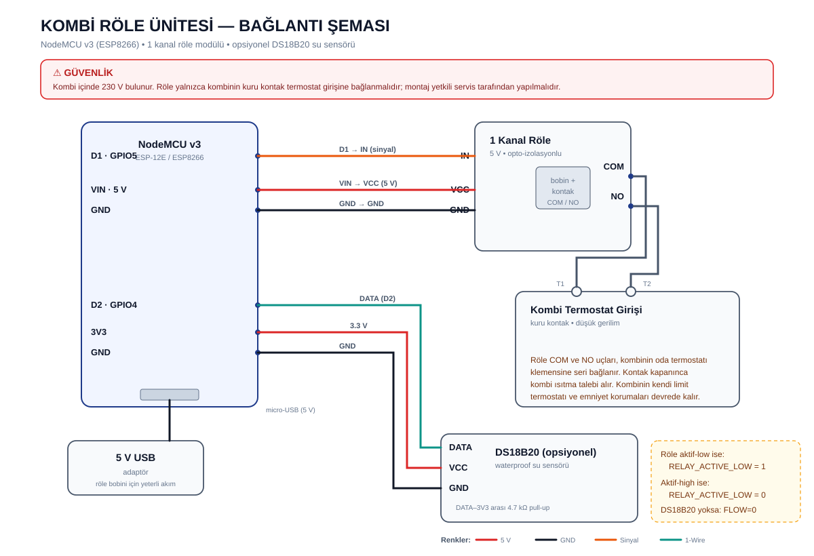

<div align="center">
  
</div>

<h1 align="center">KombiPlus</h1>

<p align="center">
  <strong>A two-node, Wi-Fi room thermostat for gas combi boilers.</strong><br>
  NodeMCU v3 (ESP8266) · OLED · rotary encoder · embedded web UI · MQTT · Telegram · fail-safe relay
</p>

<p align="center">
  
  
  
  
  
  
</p>

<p align="center">
  <strong>Languages:</strong>
  <a href="README.md">English</a> ·
  <a href="README.tr.md">Türkçe</a> ·
  <a href="README.ru.md">Русский</a> ·
  <a href="README.es.md">Español</a> ·
  <a href="README.pt.md">Português</a> ·
  <a href="README.ja.md">日本語</a> ·
  <a href="README.ko.md">한국어</a> ·
  <a href="README.zh.md">中文</a>
</p>

---

**Contents:** [How it works](#how-it-works) · [Screens](#screens) · [Features](#features) · [Hardware](#hardware) · [Repository layout](#repository-layout) · [Quick start](#quick-start) · [Control logic](#control-logic) · [Fail-safe](#fail-safe-relay) · [Protocol](#protocol) · [Web API](#web-api) · [MQTT & Telegram](#mqtt--telegram) · [Storage & themes](#storage--oled-themes) · [Safety](#safety) · [Version](#version)

---

## How it works

```
┌─────────────────────────┐        Wi-Fi AP (KombiPlus)        ┌──────────────────────┐
│  ROOM UNIT              │◄─────────────────────────────────────►│  BOILER RELAY UNIT   │
│  NodeMCU v3             │   TCP 8266: SET heat=0/1 sp=...      │  NodeMCU v3 + relay  │
│  DHT11/22 or DS18B20    │◄──────────────────────────────────────│  optional DS18B20    │
│  OLED + encoder + web   │        STATUS relay=... flow=...     │  COM/NO → boiler     │
└───────────┬─────────────┘                                      └──────────┬───────────┘
            │                                                               │
   Phone / PC (http://192.168.4.1)                           Boiler thermostat terminal
   Optional home Wi-Fi (STA)                                  (dry contact, low voltage)
```

- The room unit **always** broadcasts its own Wi-Fi access point. Connect a phone to it
  and open `192.168.4.1` — no app, no cloud, no account.
- **Captive portal:** joining that access point opens the interface automatically. Every DNS
  query resolves to the device and the operating system's connectivity probes
  (`/generate_204`, `/hotspot-detect.html`, `/ncsi.txt`, …) are redirected to the UI.
- **Web-based first setup:** the same page shows a setup card on a new device, so the language
  and the home Wi-Fi can be configured from the browser — the encoder is optional.
- Optionally it also joins the home network (STA). The access point never turns off,
  because the relay unit depends on it.
- The room unit computes heat demand from temperature, setpoint and hysteresis and
  pushes it to the relay unit every 2 seconds.
- The relay unit applies the demand and — if no command arrives for **5 minutes** —
  falls back to the configured fail-safe behaviour.
- Optional waterproof DS18B20 reports boiler flow temperature back to the room unit.
- **Sleep mode**, **holiday-free frost protection**, **boost**, **OLED theme engine**,
  **hourly history**, **LittleFS file manager** and **OTA updates** are built in.

<p align="center">
  
</p>

---

## Screens

<table>
<tr>
<td width="50%"></td>
<td width="50%"></td>
</tr>
<tr>
<td align="center"><sub>Five OLED pages in ten themes, rendered by the same drawing code as the firmware</sub></td>
<td align="center"><sub>The real embedded web UI, served from <code>web_ui.h</code></sub></td>
</tr>
</table>

Both screens come from the hardware-free browser demo: open **[`demo/demo.html`](demo/demo.html)**
by double-clicking it. It runs a mock API inside the browser, so nothing is installed.

---

## Features

### Room unit (`oda_termostati/`)

- **Sensor choice** — DHT11, DHT22 or DS18B20 with a single `#define`
- **0.96" SSD1306 OLED** (128×64, I²C): 4× room temperature that blinks while heating;
  the first encoder turn only opens target edit mode (the value does not change), further turns
  step it and show the target in the same spot for 10 s; plus network/info/sleep pages
- **KY-040 rotary encoder** — turn to set the setpoint, short press for pages, long press for mode
- **Status band** — the yellow top 16 px shows separate sensor, boiler-link and Wi-Fi icons,
  the current time on the right, and page dots; the room temperature is the biggest item on
  the main page, the target only appears for 10 s after a turn, and humidity only appears
  when the sensor reports it
- **10 built-in OLED themes** in editable `/themes/*.txt` — all share one main-screen layout and
  differ only in the status icons and the large temperature font; hold the encoder button and
  turn to switch
- **Mobile-first web UI** — setpoint, mode, boost, sleep, relay behaviour, MQTT/Telegram,
  history chart, hysteresis, calibration, frost protection, **Wi-Fi network scanner**, system info
- **8 UI languages** — English, Turkish, Russian, Spanish, Portuguese, Japanese, Korean and
  Chinese. On first boot the room unit asks for a language (OLED: turn to pick, press to confirm;
  web UI: full-screen picker) and keeps it as `lang=`; change it any time from the *Language*
  card. OLED labels cover en/tr/es/pt — the built-in font is ASCII-only, so other languages fall
  back to English on the display.

  The picker is for **new devices only**: a board with no `/config.txt` yet asks (and keeps asking
  until a language is chosen), while a unit updating from an earlier firmware keeps its existing
  settings and boots straight into English without a prompt — the web UI then follows the browser
  language until a language is picked in the *Language* card. The answer is recorded as
  `langset=1` next to `lang=` so an upgrade never re-asks.
- **Sleep mode** — a different setpoint inside a time window (NTP clock)
- **MQTT** — retained status JSON + `key=value` commands
- **Telegram bot** — status and control, restricted to one chat ID
- **LittleFS** — settings in `/config.txt`, hourly samples in `/history.csv`, file manager at `/fs`
- **Hysteresis + minimum on/off times** to stop short cycling
- **Boost** — temporarily raises the target by 1.5 °C for 5/15/30 minutes
- **Frost protection** — heats below 5 °C even when the mode is off
- **Fail-safe** — demand is cut on sensor error or lost relay link
- **OTA** (STA only) and mDNS: `http://termostat.local`

### Relay unit (`kombi_rolesi/`)

- Joins the room unit's access point automatically
- Drives the boiler's **dry contact** through an opto-isolated relay module
- **Active-low / active-high** selection in one line
- **Fail-safe:** after 5 minutes without a command, close the relay (default) or hold the last demand
- The fail-safe preference arrives from the room unit (`fs=0/1`) and survives reboots (EEPROM)
- Relay **always starts closed/off** after power-up
- Optional DS18B20 boiler flow temperature reporting
- On-board LED link indicator, verbose 115200 serial log

---

## Hardware

| Qty | Part |
|----:|------|
| 2 | NodeMCU v3 / ESP8266 (Lolin) |
| 1 | 0.96" SSD1306 OLED, I²C, 128×64 |
| 1 | KY-040 rotary encoder |
| 1 | DHT11 / DHT22 / DS18B20 (+ 4.7 kΩ for DS18B20) |
| 1 | Opto-isolated 5 V relay module (1 channel) |
| 1 | Optional waterproof DS18B20 (boiler flow) |
| 2 | 5 V USB adapters, jumpers, screw terminals |

<table>
<tr>
<td width="50%"></td>
<td width="50%"></td>
</tr>
<tr>
<td align="center"><sub>Room unit — OLED, encoder, sensor</sub></td>
<td align="center"><sub>Relay unit — boiler dry contact</sub></td>
</tr>
</table>

| Room unit | GPIO | Connects to |
|-----------|------|-------------|
| D5 | GPIO14 | OLED SCL |
| D6 | GPIO12 | OLED SDA |
| D4 | GPIO2 | Sensor DATA (DHT or DS18B20) |
| D1 | GPIO5 | Encoder CLK |
| D2 | GPIO4 | Encoder DT |
| D7 | GPIO13 | Encoder SW (button) |

| Relay unit | GPIO | Connects to |
|------------|------|-------------|
| D1 | GPIO5 | Relay IN |
| VIN | — | Relay VCC (5 V) |
| GND | — | Relay GND |
| D2 | GPIO4 | Optional DS18B20 DATA |

Full pin tables, notes and troubleshooting live in
[`oda_termostati/README.md`](oda_termostati/README.md) and [`kombi_rolesi/README.md`](kombi_rolesi/README.md).

---

## Repository layout

```
kombi/
├── README.md                  ← English (this file) + 7 translations
├── CHANGELOG.md               ← release history
├── LICENSE                    ← MIT
├── oda_termostati/
│   ├── oda_termostati.ino     ← room unit firmware
│   ├── web_ui.h               ← embedded HTML/CSS/JS
│   ├── src/LittleFSExplorer/  ← vendored file manager (MIT)
│   ├── src/OledTheme/         ← OLED theme engine (10 themes)
│   └── README.md
├── kombi_rolesi/
│   ├── kombi_rolesi.ino       ← relay unit firmware
│   └── README.md
├── demo/
│   ├── demo.html              ← hardware-free UI demo (open in a browser)
│   ├── demo.src.html          ← demo template
│   ├── web_ui_demo.html       ← generated standalone web UI
│   └── build_demo.ps1         ← regenerates the demo from web_ui.h
└── docs/
    ├── images/                ← banner, screenshots
    └── *.svg                  ← wiring and architecture diagrams
```

---

## Quick start

### 1. Arduino environment

1. **Arduino IDE 2.x** → *Preferences* → *Additional boards manager URLs*:

   ```
   https://arduino.esp8266.com/stable/package_esp8266com_index.json
   ```

2. *Boards Manager* → install **esp8266** `3.1.2`.
3. *Library Manager* → install:

   `Adafruit SSD1306`, `Adafruit GFX Library`, `DHT sensor library`,
   `Adafruit Unified Sensor`, `OneWire`, `DallasTemperature`, `PubSubClient`.

   `LittleFSExplorer` and the OLED theme engine are **vendored** in
   `oda_termostati/src/` — nothing else to install.

4. Board: **NodeMCU 1.0 (ESP-12E Module)**, upload speed **115200**, flash 4 MB.

### 2. Configure

Use the **same access point credentials in both sketches**:

```cpp
// oda_termostati.ino
#define AP_SSID  "KombiPlus"
#define AP_PASS  "Kombi.1881"

// kombi_rolesi.ino
#define TERMOSTAT_AP_SSID  "KombiPlus"
#define TERMOSTAT_AP_PASS  "Kombi.1881"
```

Pick the sensor in the room unit:

```cpp
#define SENSOR_TYPE  SENSOR_DHT22   // SENSOR_DHT11 / SENSOR_DHT22 / SENSOR_DS18B20
```

Active-high relay boards:

```cpp
#define RELAY_ACTIVE_LOW  0
```

### 3. Flash and test

1. Flash the **relay unit** first (leave the boiler contact disconnected).
2. Flash the **room unit**.
3. Join `KombiPlus` (password `Kombi.1881`) and open `http://192.168.4.1`.
4. The relay serial log should print `Oda unitesine baglandi.` and the web UI shows **Boiler linked**.
5. Only after testing, have a **qualified technician** connect the relay contact to the
   boiler thermostat terminal.

---

## Control logic

```
Effective target = mode ON  → sleep target when sleep is active, otherwise setpoint
                             (+1.5 °C while boost is running)
                   mode OFF → frost protection (default 5 °C)

Demand ON : temp ≤ target − hysteresis  AND  ≥ 180 s since last off
Demand OFF: temp ≥ target + hysteresis  AND  ≥ 60 s since last on
```

| Parameter | Default | Range |
|-----------|---------|-------|
| Setpoint | 21.0 °C | 5–30 °C |
| Hysteresis | 0.3 °C | 0.1–3.0 °C |
| Minimum on time | 60 s | fixed |
| Minimum off time | 180 s | fixed |
| Frost protection | 5.0 °C | 2–10 °C |
| Boost | +1.5 °C | 5/15/30 min |
| Sleep mode | off | 23:00–07:00, 18.0 °C |
| Relay fail-safe | close | close / hold last demand |
| Hourly history | 720 samples | ~30 days |

Sensor data older than 30 seconds cuts the demand. Mode OFF still heats below the frost limit.

---

## Fail-safe relay

The relay only closes while `heat=1` **and** the last command is younger than 5 minutes.

- `fs=0` **(default)** — relay opens; the boiler stops. Safe choice.
- `fs=1` — last demand is held. Reduces freezing risk but can overheat the house; use it
  **only** when the boiler has its own safety thermostat and limit protection.
- The relay always boots with the contact open, so a power cut can never start heating by itself.

---

## Protocol

The room unit listens on **TCP 8266**; the relay unit is the client. Line-based ASCII:

| Direction | Line |
|-----------|------|
| Room → Relay | `SET heat=1 sp=21.0 hyst=0.3 mode=1 fs=0\n` |
| Relay → Room | `STATUS relay=1 flow=42.50 rssi=-58 up=123 fs=0 fw=1.1.0\n` |

Both directions are visible in the serial logs at 115200 baud.

---

## Web API

The embedded web server serves JSON on port 80 — handy for Home Assistant, scripts or curl.

| Method | Path | Example |
|--------|------|---------|
| GET | `/api/status` | Full status JSON |
| GET | `/api/set?sp=22.0` | Setpoint |
| GET | `/api/set?mode=0` | Mode off |
| GET | `/api/set?hyst=0.4&cal=-0.2&frost=6` | Tuning |
| GET | `/api/set?boost=15` | 15 min boost (`0` cancels) |
| GET | `/api/set?sleep=1&sleepstart=23:00&sleepend=07:00&sleepsp=18` | Sleep mode |
| GET | `/api/set?failsafe=1` | Relay fail-safe: hold last demand |
| GET | `/api/set?lang=ja` | Interface language: en/tr/ru/es/pt/ja/ko/zh |
| GET | `/api/set?theme=klasik` | Select OLED theme |
| GET | `/api/theme` | Theme list + active theme |
| GET | `/api/theme?set=klasik` | Select a theme |
| GET | `/api/theme?step=1` | Next theme (`-1` = previous) |
| GET | `/api/theme?reload=1` | Re-read theme files |
| POST | `/api/net` | MQTT / Telegram settings |
| GET | `/api/history?hours=24` | History points |
| POST | `/api/history/sample` | Store a sample now |
| POST | `/api/history/clear` | Erase history |
| GET | `/api/scan` | Nearby Wi-Fi networks (`nets[]`) |
| POST | `/api/wifi` | `ssid`, `pass` form fields |
| POST | `/api/reboot` | Restart |
| GET | `/fs` | LittleFS file manager |
| GET | `/test` | Panel simulation: live OLED mirror + virtual encoder/button |
| GET | `/api/oled` | OLED framebuffer as hex (`px`) with `page`, `invert`, `dim`, `ask` |
| GET/POST | `/api/encoder?steps=1` | Simulate encoder clicks (negative turns left) |
| GET/POST | `/api/button?ms=120` | Simulate a button press (`ms` >= 1200 toggles the mode) |

`/api/status` keys: `fw, theme, temp, hum, sp, eff, hyst, cal, frost, mode, demand, relay,
link, flow, brssi, boost, boostMin, sensorOk, sleepEn, sleep, sleepStart, sleepEnd, sleepSp,
failsafe, mqtt, mqttCfg, mqttPort, mqttPrefix, tg, tgOk, tgErr, tgChat, timeOk, now, hist,
fsUsed, fsTotal, uptime, ip, apip, ssid, sta, rssi, heap, client`.

---

## MQTT & Telegram

**MQTT** (web → *MQTT & Telegram*):

- `kombi/status` — retained JSON (`temp`, `sp`, `eff`, `mode`, `demand`, `relay`, `link`, `sleep`, `failsafe`, `boost`, …)
- `kombi/set` — `sp=22.5`, `mode=1`, `sleepsp=18`, `sleepstart=23:00&sleepend=07:00`, `failsafe=1`
- `kombi/result` — `ok` / error

**Telegram**: commands follow the interface language — `/durum`, `/sicaklik 22.5`,
`/mod ac|kapat`, `/boost 30`, `/uyku ac|kapat`, `/uykusaat 23:00 07:00`, `/uykusicaklik 18`,
`/yardim` in Turkish, with the equivalents of the selected language (English always works too).
Replies and the `/help` list come in the selected language. Only the configured chat ID is served.

---

## Storage & OLED themes

- `/config.txt` — all settings (`key=value`), migrated automatically from the old EEPROM layout
- `/history.csv` — hourly samples: `time, room, humidity, setpoint, demand, sleep`
- `/themes/*.txt` — theme definitions (`id, header, tempsize, separator, status, nem, boost, su,
  sayfa, etiket, ters, dim, ikon, font`); regenerated on first boot if missing
- `/themes/active.txt` — last selected theme id
- Web UI draws 24 h / 7 d / 30 d history charts; `/fs` lets you list, download, upload, delete
  and edit files

Ten built-in themes — `klasik`, `ince`, `dolu`, `kutu`, `nokta`, `dijital`, `neon`, `panel`,
`minimal`, `retro` — share the main-screen layout and differ only in the status icons
(`ikon=0..4`: line, thin, filled, boxed, dotted) and the large temperature font (`font=0`:
GFX, `font=1`: seven-segment). Hold the encoder button and turn right/left (or hold the
left/right buttons on `/test`) to switch the theme; the active screen redraws immediately.

---

## Safety

- A gas boiler contains **230 V**; only a qualified technician may open it or wire the contact.
- The relay is wired as a **potential-free dry contact** to the boiler thermostat input.
- Use an **opto-isolated** relay module, a suitable fuse and a quality 5 V supply.
- Change AP and OTA passwords in production; keep the access point away from guests.
- This project is a hobby/improvement build with **no warranty**; you own the risk.
- Keep the boiler's own safety thermostat and limit protection in the loop at all times.

---

## Version

- **v1.1.0** — ten OLED themes, a room-temperature-first main screen and web-based first setup
  (see [CHANGELOG.md](CHANGELOG.md))
- **v1.0.0** — first stable release (see [CHANGELOG.md](CHANGELOG.md))
- Tested platform: ESP8266 Arduino core 3.1.2, Arduino IDE 2.x
- Room unit IRAM is ~95 % full (`TELEGRAM_ENABLED 0` frees room if needed)
- Keep both devices' `FW_VERSION` and AP settings in sync when you change anything

---

## License

[MIT](LICENSE) — free to use, change and share. `LittleFSExplorer` keeps its own MIT license.
