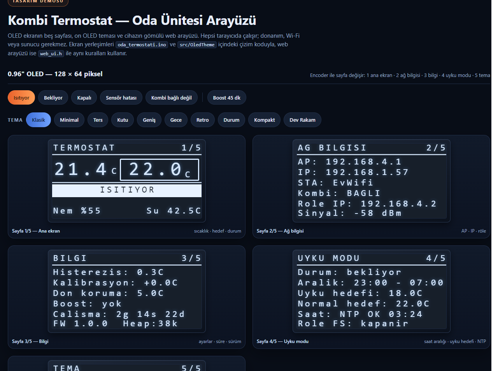

<div align="center">
  
</div>

<h1 align="center">KombiPlus</h1>

<p align="center">
  <strong>Termostato de ambiente Wi-Fi de dois módulos para caldeiras a gás.</strong><br>
  NodeMCU v3 (ESP8266) · OLED · encoder rotativo · interface web embutida · MQTT · Telegram · relé fail-safe
</p>

<p align="center">
  
  
  
  
  
</p>

<p align="center">
  <strong>Idiomas:</strong>
  <a href="README.md">English</a> ·
  <a href="README.tr.md">Türkçe</a> ·
  <a href="README.ru.md">Русский</a> ·
  <a href="README.es.md">Español</a> ·
  <a href="README.pt.md">Português</a> ·
  <a href="README.ja.md">日本語</a> ·
  <a href="README.ko.md">한국어</a> ·
  <a href="README.zh.md">中文</a>
</p>

---

**Conteúdo:** [Como funciona](#como-funciona) · [Telas](#telas) · [Recursos](#recursos) · [Hardware](#hardware) · [Estrutura](#estrutura-do-repositório) · [Início rápido](#início-rápido) · [Lógica](#lógica-de-controle) · [Fail-safe](#relé-fail-safe) · [Protocolo](#protocolo) · [API web](#api-web) · [MQTT e Telegram](#mqtt-e-telegram) · [Memória e temas](#memória-e-temas-oled) · [Segurança](#segurança) · [Versão](#versão)

---

## Como funciona

```
┌─────────────────────────┐        Wi-Fi AP (KombiPlus)        ┌──────────────────────┐
│  UNIDADE DE AMBIENTE    │◄─────────────────────────────────────►│  UNIDADE DE RELÉ     │
│  NodeMCU v3             │   TCP 8266: SET heat=0/1 sp=...      │  NodeMCU v3 + relé   │
│  DHT11/22 ou DS18B20    │◄──────────────────────────────────────│  DS18B20 opcional    │
│  OLED + encoder + web   │        STATUS relay=... flow=...     │  COM/NO → caldeira   │
└───────────┬─────────────┘                                      └──────────┬───────────┘
            │                                                               │
   Celular / PC (http://192.168.4.1)                            Borne do termostato
   Wi-Fi de casa (STA, opcional)                                (contato seco, baixa tensão)
```

- A unidade de ambiente **sempre** cria a própria rede Wi-Fi. Conecte o celular e abra
  `192.168.4.1` — sem app, sem nuvem, sem conta.
- Opcionalmente também entra na rede de casa (STA). O ponto de acesso nunca desliga,
  porque a unidade de relé depende dele.
- A cada 2 segundos calcula a demanda de calor (temperatura, setpoint e histerese) e
  envia para a unidade de relé.
- A unidade de relé aplica a demanda; sem comandos por **5 minutos**, usa o comportamento
  fail-safe configurado.
- Um DS18B20 à prova d'água opcional informa a temperatura da água da caldeira.
- Inclui **modo dormir**, **proteção antigelo**, **boost**, **10 temas OLED**,
  **histórico horário**, **gerenciador LittleFS** e **OTA**.

<p align="center">
  
</p>

---

## Telas

<table>
<tr>
<td width="50%"></td>
<td width="50%"></td>
</tr>
<tr>
<td align="center"><sub>Cinco páginas OLED em dez temas, com o mesmo código de desenho do firmware</sub></td>
<td align="center"><sub>A interface web real, servida por <code>web_ui.h</code></sub></td>
</tr>
</table>

As duas imagens vêm da demo sem hardware: abra **[`demo/demo.html`](demo/demo.html)** com
dois cliques. A demo executa uma API simulada dentro do navegador.

---

## Recursos

### Unidade de ambiente (`oda_termostati/`)

- **Sensor selecionável:** DHT11, DHT22 ou DS18B20 com um único `#define`
- **OLED 0.96" SSD1306** (128×64, I²C): temperatura, setpoint, estado, rede e informações
- **Encoder KY‑040:** girar ajusta o setpoint, toque curto troca a página, toque longo o modo
- **10 temas OLED** em arquivos editáveis `/themes/*.txt` no LittleFS
- **8 idiomas de interface** — inglês, turco, russo, espanhol, português, japonês, coreano e
  chinês. No primeiro boot a unidade pede o idioma (OLED: girar para escolher, pressionar para
  confirmar; web: seletor em tela cheia) e o salva como `lang=`. No OLED valem en/tr/es/pt
  (fonte apenas ASCII); os demais aparecem em inglês.
- **Interface web para celular:** setpoint, modo, boost, modo dormir, comportamento do relé,
  MQTT/Telegram, gráfico do histórico, histerese, calibração, antigelo,
  **varredura de redes Wi-Fi** e informações do sistema
- **Modo dormir:** setpoint diferente em uma faixa de horário (relógio NTP)
- **MQTT:** JSON de estado retido + comandos `chave=valor`
- **Bot do Telegram:** estado e controle apenas no chat configurado
- **LittleFS:** ajustes em `/config.txt`, histórico em `/history.csv`, gerenciador em `/fs`
- **Histerese + tempos mínimos de liga/desliga** contra ciclos curtos
- **Boost:** +1.5 °C por 5/15/30 minutos
- **Antigelo:** aquece abaixo de 5 °C mesmo com o modo desligado
- **Fail-safe:** corta a demanda se o sensor falhar ou o relé se desconectar
- **OTA** (só com STA) e mDNS: `http://termostat.local`

### Unidade de relé (`kombi_rolesi/`)

- Conecta-se sozinha ao ponto de acesso da unidade de ambiente
- Aciona o **contato seco** da caldeira com módulo de relé optoacoplado
- **Ativo baixo / ativo alto** em uma linha
- **Fail-safe:** após 5 minutos sem comandos abre o relé (padrão) ou mantém a última demanda
- A preferência vem da unidade de ambiente (`fs=0/1`) e é gravada na EEPROM
- O relé **sempre inicia aberto** ao energizar
- DS18B20 opcional para a temperatura da água
- LED de link e log serial detalhado a 115200

---

## Hardware

| Qtd. | Componente |
|-----:|------------|
| 2 | NodeMCU v3 / ESP8266 (Lolin) |
| 1 | OLED 0.96" SSD1306, I²C, 128×64 |
| 1 | Encoder rotativo KY‑040 |
| 1 | DHT11 / DHT22 / DS18B20 (+ 4.7 kΩ para DS18B20) |
| 1 | Módulo de relé 5 V optoacoplado (1 canal) |
| 1 | DS18B20 à prova d'água opcional |
| 2 | Fontes USB 5 V, jumpers, bornes |

<table>
<tr>
<td width="50%"></td>
<td width="50%"></td>
</tr>
<tr>
<td align="center"><sub>Unidade de ambiente — OLED, encoder, sensor</sub></td>
<td align="center"><sub>Unidade de relé — contato seco da caldeira</sub></td>
</tr>
</table>

| Unidade de ambiente | GPIO | Ligação |
|---------------------|------|---------|
| D5 | GPIO14 | OLED SCL |
| D6 | GPIO12 | OLED SDA |
| D4 | GPIO2 | DATA do sensor (DHT ou DS18B20) |
| D1 | GPIO5 | Encoder CLK |
| D2 | GPIO4 | Encoder DT |
| D7 | GPIO13 | Encoder SW (botão) |

| Unidade de relé | GPIO | Ligação |
|-----------------|------|---------|
| D1 | GPIO5 | Entrada IN do relé |
| VIN | — | VCC do relé (5 V) |
| GND | — | GND comum |
| D2 | GPIO4 | DS18B20 DATA (opcional) |

Tabelas de pinos, notas e solução de problemas em
[`oda_termostati/README.md`](oda_termostati/README.md) e [`kombi_rolesi/README.md`](kombi_rolesi/README.md).

---

## Estrutura do repositório

```
kombi/
├── README.md                  ← inglês (principal) + 7 traduções
├── CHANGELOG.md               ← histórico de versões
├── LICENSE                    ← MIT
├── oda_termostati/
│   ├── oda_termostati.ino     ← firmware da unidade de ambiente
│   ├── web_ui.h               ← HTML/CSS/JS embutido
│   ├── src/LittleFSExplorer/  ← gerenciador de arquivos (MIT)
│   ├── src/OledTheme/         ← motor de temas OLED (10 temas)
│   └── README.md
├── kombi_rolesi/
│   ├── kombi_rolesi.ino       ← firmware da unidade de relé
│   └── README.md
├── demo/
│   ├── demo.html              ← demo da interface sem hardware
│   ├── demo.src.html          ← modelo da demo
│   ├── web_ui_demo.html       ← interface web gerada
│   └── build_demo.ps1         ← regenera a demo a partir de web_ui.h
└── docs/
    ├── images/                ← banner, capturas
    └── *.svg                  ← diagramas de ligação e arquitetura
```

---

## Início rápido

### 1. Ambiente Arduino

1. **Arduino IDE 2.x** → *Preferences* → *Additional boards manager URLs*:

   ```
   https://arduino.esp8266.com/stable/package_esp8266com_index.json
   ```

2. *Boards Manager* → instale **esp8266** `3.1.2`.
3. *Library Manager* → instale:

   `Adafruit SSD1306`, `Adafruit GFX Library`, `DHT sensor library`,
   `Adafruit Unified Sensor`, `OneWire`, `DallasTemperature`, `PubSubClient`.

   `LittleFSExplorer` e o motor de temas já estão em `oda_termostati/src/`.

4. Placa: **NodeMCU 1.0 (ESP‑12E Module)**, velocidade **115200**, flash 4 MB.

### 2. Configuração

**Use as mesmas credenciais do ponto de acesso nos dois sketches:**

```cpp
// oda_termostati.ino
#define AP_SSID  "KombiPlus"
#define AP_PASS  "Kombi.1881"

// kombi_rolesi.ino
#define TERMOSTAT_AP_SSID  "KombiPlus"
#define TERMOSTAT_AP_PASS  "Kombi.1881"
```

Escolha o sensor na unidade de ambiente:

```cpp
#define SENSOR_TYPE  SENSOR_DHT22   // SENSOR_DHT11 / SENSOR_DHT22 / SENSOR_DS18B20
```

Módulo de relé ativo alto:

```cpp
#define RELAY_ACTIVE_LOW  0
```

### 3. Gravar e testar

1. Grave primeiro a **unidade de relé** (sem ligar o contato à caldeira).
2. Grave a **unidade de ambiente**.
3. Conecte-se a `KombiPlus` (senha `Kombi.1881`) e abra `http://192.168.4.1`.
4. O log do relé mostra `Oda unitesine baglandi.` e a interface exibe **Kombi bağlı**.
5. Só depois dos testes, peça a um **técnico autorizado** para ligar o contato do relé ao
   borne do termostato da caldeira.

---

## Lógica de controle

```
Setpoint efetivo = modo ON  → setpoint do modo dormir, se ativo, senão o normal
                              (+1.5 °C durante o boost)
                   modo OFF → proteção antigelo (5 °C)

Demanda ON : T ≤ setpoint − histerese  E  ≥ 180 s desde o último desligamento
Demanda OFF: T ≥ setpoint + histerese  E  ≥ 60 s desde a última ligação
```

| Parâmetro | Padrão | Faixa |
|-----------|--------|-------|
| Setpoint | 21.0 °C | 5–30 °C |
| Histerese | 0.3 °C | 0.1–3.0 °C |
| Tempo mínimo ligado | 60 s | fixo |
| Tempo mínimo desligado | 180 s | fixo |
| Antigelo | 5.0 °C | 2–10 °C |
| Boost | +1.5 °C | 5/15/30 min |
| Modo dormir | desligado | 23:00–07:00, 18.0 °C |
| Fail-safe do relé | abre | abre / mantém demanda |
| Histórico horário | 720 amostras | ~30 dias |

Leituras com mais de 30 segundos cortam a demanda. Com o modo desligado, o antigelo continua ativo.

---

## Relé fail-safe

O relé só fecha enquanto `heat=1` **e** o último comando tem menos de 5 minutos.

- `fs=0` **(padrão)** — o relé abre e a caldeira para. Opção segura.
- `fs=1` — mantém a última demanda. Reduz o risco de congelamento, mas pode superaquecer;
  use **somente** se a caldeira tiver termostato de segurança próprio.
- O relé sempre inicia aberto, então uma queda de energia não liga o aquecimento.

---

## Protocolo

A unidade de ambiente escuta em **TCP 8266**; a de relé é o cliente. ASCII por linhas:

| Direção | Linha |
|---------|-------|
| Ambiente → Relé | `SET heat=1 sp=21.0 hyst=0.3 mode=1 fs=0\n` |
| Relé → Ambiente | `STATUS relay=1 flow=42.50 rssi=-58 up=123 fs=0 fw=1.2.0\n` |

Os dois sentidos aparecem nos logs seriais a 115200.

---

## API web

O servidor embutido entrega JSON na porta 80 — útil para Home Assistant, scripts ou curl.

| Método | Rota | Exemplo |
|--------|------|---------|
| GET | `/api/status` | Estado completo em JSON |
| GET | `/api/set?sp=22.0` | Setpoint |
| GET | `/api/set?mode=0` | Desligar modo |
| GET | `/api/set?hyst=0.4&cal=-0.2&frost=6` | Ajustes |
| GET | `/api/set?boost=15` | Boost 15 min (`0` cancela) |
| GET | `/api/set?sleep=1&sleepstart=23:00&sleepend=07:00&sleepsp=18` | Modo dormir |
| GET | `/api/set?failsafe=1` | Relé: manter demanda |
| GET | `/api/set?theme=gece` | Escolher tema OLED |
| GET | `/api/theme` | Lista de temas + ativo |
| GET | `/api/theme?set=retro` | Escolher tema |
| GET | `/api/theme?reload=1` | Reler arquivos de temas |
| POST | `/api/net` | Ajustes MQTT / Telegram |
| GET | `/api/history?hours=24` | Pontos do histórico |
| POST | `/api/history/sample` | Salvar uma amostra |
| POST | `/api/history/clear` | Apagar histórico |
| GET | `/api/scan` | Redes Wi-Fi próximas (`nets[]`) |
| POST | `/api/wifi` | Campos `ssid`, `pass` |
| POST | `/api/reboot` | Reiniciar |
| GET | `/fs` | Gerenciador de arquivos LittleFS |

Campos de `/api/status`: `fw, theme, temp, hum, sp, eff, hyst, cal, frost, mode, demand, relay,
link, flow, brssi, boost, boostMin, sensorOk, sleepEn, sleep, sleepStart, sleepEnd, sleepSp,
failsafe, mqtt, mqttCfg, mqttPort, mqttPrefix, tg, tgOk, tgErr, tgChat, timeOk, now, hist,
fsUsed, fsTotal, uptime, ip, apip, ssid, sta, rssi, heap, client`.

---

## MQTT e Telegram

**MQTT** (web → *MQTT & Telegram*):

- `kombi/status` — JSON retido (`temp`, `sp`, `eff`, `mode`, `demand`, `relay`, `link`, `sleep`, `failsafe`, `boost`, …)
- `kombi/set` — `sp=22.5`, `mode=1`, `sleepsp=18`, `sleepstart=23:00&sleepend=07:00`, `failsafe=1`
- `kombi/result` — `ok` / erro

**Telegram**: `/durum`, `/sicaklik 22.5`, `/mod ac|kapat`, `/boost 30`, `/uyku ac|kapat`,
`/uykusaat 23:00 07:00`, `/uykusicaklik 18`, `/yardim`. Só o chat configurado é atendido.

---

## Memória e temas OLED

- `/config.txt` — todos os ajustes (`chave=valor`), migração automática da EEPROM antiga
- `/history.csv` — amostras horárias: `hora, ambiente, umidade, setpoint, demanda, dormir`
- `/themes/*.txt` — definições de tema (`id, header, tempsize, separator, status, nem, boost,
  su, sayfa, etiket, ters, dim`); recriadas no primeiro boot se faltarem
- `/themes/active.txt` — id do último tema
- A web desenha gráficos de 24 h / 7 d / 30 d; `/fs` lista, baixa, envia, apaga e edita arquivos

Temas incluídos: `klasik`, `ince`, `dolu`, `kutu`, `nokta`, `dijital`, `neon`, `panel`,
`minimal`, `retro`.

---

## Segurança

- Uma caldeira a gás tem **230 V**; só um técnico autorizado deve abri-la ou ligar o contato.
- O relé é ligado como **contato seco** na entrada do termostato da caldeira.
- Use módulo de relé **optoacoplado**, fusível adequado e fonte de 5 V de qualidade.
- Troque as senhas de AP e OTA em produção; não deixe a rede aberta a visitantes.
- Projeto amador, **sem garantia**; o risco é do usuário.
- O termostato de segurança e a proteção de limite da caldeira devem permanecer ativos.

---

## Versão

- **v1.2.0** — a unidade de rel00e9 agora pode mostrar seu estado em um OLED opcional ([CHANGELOG.md](CHANGELOG.md))
- **v1.1.1** — a temperatura ambiente ocupa a tela inteira; a umidade e a 00e1gua da caldeira foram para a faixa superior ([CHANGELOG.md](CHANGELOG.md))
- **v1.1.0** — dez temas OLED, tela principal centrada na temperatura ambiente e configuração inicial pelo navegador ([CHANGELOG.md](CHANGELOG.md))
- **v1.0.0** — primeira versão estável ([CHANGELOG.md](CHANGELOG.md))
- Testado com: ESP8266 Arduino core 3.1.2, Arduino IDE 2.x
- A IRAM da unidade de ambiente está em ~95 % (`TELEGRAM_ENABLED 0` libera espaço)
- Mantenha `FW_VERSION` e os dados AP dos dois dispositivos sincronizados ao alterar algo

---

## Licença

[MIT](LICENSE) — livre para usar, modificar e compartilhar. `LittleFSExplorer` mantém sua licença MIT.
