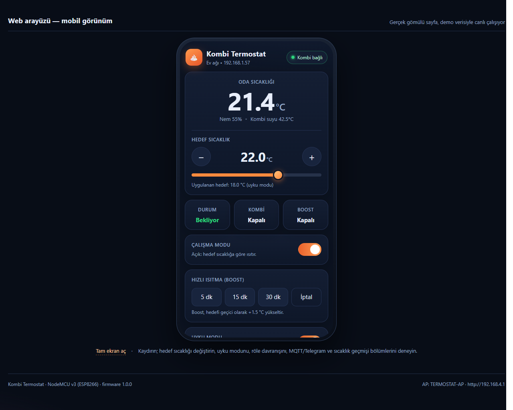

<div align="center">
  
</div>

<h1 align="center">KombiPlus</h1>

<p align="center">
  <strong>面向燃气壁挂炉的双节点 Wi-Fi 室内温控器。</strong><br>
  NodeMCU v3（ESP8266）· OLED · 旋转编码器 · 内置网页界面 · MQTT · Telegram · 失效安全继电器
</p>

<p align="center">
  
  
  
  
  
</p>

<p align="center">
  <strong>语言:</strong>
  <a href="README.md">English</a> ·
  <a href="README.tr.md">Türkçe</a> ·
  <a href="README.ru.md">Русский</a> ·
  <a href="README.es.md">Español</a> ·
  <a href="README.pt.md">Português</a> ·
  <a href="README.ja.md">日本語</a> ·
  <a href="README.ko.md">한국어</a> ·
  <a href="README.zh.md">中文</a>
</p>

---

**目录：** [工作原理](#工作原理) · [界面](#界面) · [功能](#功能) · [硬件](#硬件) · [仓库结构](#仓库结构) · [快速开始](#快速开始) · [控制逻辑](#控制逻辑) · [失效安全](#失效安全继电器) · [通信协议](#通信协议) · [Web API](#web-api) · [MQTT 与 Telegram](#mqtt-与-telegram) · [存储与主题](#存储与-oled-主题) · [安全](#安全) · [版本](#版本)

---

## 工作原理

```
┌─────────────────────────┐        Wi-Fi AP (KombiPlus)        ┌──────────────────────┐
│  室内单元                │◄─────────────────────────────────────►│  锅炉继电器单元        │
│  NodeMCU v3             │   TCP 8266: SET heat=0/1 sp=...      │  NodeMCU v3 + 继电器  │
│  DHT11/22 或 DS18B20    │◄──────────────────────────────────────│  可选 DS18B20        │
│  OLED + 编码器 + 网页    │        STATUS relay=... flow=...     │  COM/NO → 锅炉        │
└───────────┬─────────────┘                                      └──────────┬───────────┘
            │                                                               │
   手机 / 电脑 (http://192.168.4.1)                             锅炉温控接线端子
   可选接入家庭 Wi-Fi (STA)                                     （干接点，低压）
```

- 室内单元**始终**开启自己的 Wi-Fi 热点。连接后打开 `192.168.4.1` 即可，不需要 App、云服务或账号。
- 也可以同时接入家庭 Wi-Fi（STA）。热点不会关闭，因为继电器单元依赖它。
- 每 2 秒根据温度、设定值与回差计算供热需求并发送给继电器单元。
- 继电器单元执行需求；如果 **5 分钟**内没有收到命令，则按设定的失效安全方式动作。
- 可选防水 DS18B20 回传锅炉水温。
- 内置**睡眠模式**、**防冻保护**、**Boost**、**10 套 OLED 主题**、**每小时历史记录**、
  **LittleFS 文件管理器**与 **OTA**。

<p align="center">
  
</p>

---

## 界面

<table>
<tr>
<td width="50%"></td>
<td width="50%"></td>
</tr>
<tr>
<td align="center"><sub>10 套主题下的 5 个 OLED 页面，与固件使用同一套绘制代码</sub></td>
<td align="center"><sub>由 <code>web_ui.h</code> 提供的真实网页界面</sub></td>
</tr>
</table>

两张图都来自无需硬件的浏览器演示：双击打开 **[`demo/demo.html`](demo/demo.html)**，
演示在浏览器内运行模拟 API。

---

## 功能

### 室内单元（`oda_termostati/`）

- **传感器可选：** DHT11、DHT22 或 DS18B20，改一行 `#define`
- **0.96" SSD1306 OLED**（128×64，I²C）：温度、设定值、状态、网络与信息页
- **KY‑040 旋转编码器：** 旋转调温、短按翻页、长按开关模式
- **10 套 OLED 主题**，以 `/themes/*.txt` 保存在 LittleFS 上可随时编辑
- **8 种界面语言** — 英语、土耳其语、俄语、西班牙语、葡萄牙语、日语、韩语、中文。首次开机时
  选择语言（OLED：旋转选择、按下确认；网页：全屏选择），并以 `lang=` 保存。OLED 使用 ASCII
  字体，仅支持 en/tr/es/pt，其他语言显示英文。
- **移动优先网页界面：** 设定值、模式、Boost、睡眠、继电器行为、MQTT/Telegram、
  历史曲线、回差、校准、防冻、**Wi-Fi 网络扫描**、系统信息
- **睡眠模式：** 指定时间段使用另一设定值（NTP 时间）
- **MQTT：** 保留状态 JSON + `key=value` 命令
- **Telegram 机器人：** 状态与远程控制，仅限指定会话
- **LittleFS：** 设置 `/config.txt`、每小时记录 `/history.csv`、`/fs` 文件管理器
- **回差 + 最短开/关时间**，避免频繁启停
- **Boost：** 5/15/30 分钟内目标 +1.5 °C
- **防冻：** 模式关闭时低于 5 °C 仍供热
- **失效安全：** 传感器故障或继电器断开时切断需求
- **OTA**（仅 STA）与 mDNS：`http://termostat.local`

### 继电器单元（`kombi_rolesi/`）

- 自动连接室内单元的热点
- 通过光耦隔离继电器模块驱动锅炉**干接点**
- 一行代码选择**低电平/高电平有效**
- **失效安全：** 5 分钟无命令后断开继电器（默认）或保持最后需求
- 失效安全选项由室内单元下发（`fs=0/1`）并保存在 EEPROM
- 上电时继电器**始终断开**
- 可选 DS18B20 上报锅炉水温
- 板载 LED 连接指示与 115200 详细串口日志

---

## 硬件

| 数量 | 元件 |
|-----:|------|
| 2 | NodeMCU v3 / ESP8266（Lolin） |
| 1 | 0.96" SSD1306 OLED，I²C，128×64 |
| 1 | KY‑040 旋转编码器 |
| 1 | DHT11 / DHT22 / DS18B20（DS18B20 需 4.7 kΩ） |
| 1 | 光耦隔离 5 V 继电器模块（1 路） |
| 1 | 可选防水 DS18B20（锅炉水温） |
| 2 | 5 V USB 电源、杜邦线、接线端子 |

<table>
<tr>
<td width="50%"></td>
<td width="50%"></td>
</tr>
<tr>
<td align="center"><sub>室内单元 — OLED、编码器、传感器</sub></td>
<td align="center"><sub>继电器单元 — 锅炉干接点</sub></td>
</tr>
</table>

| 室内单元 | GPIO | 连接 |
|----------|------|------|
| D5 | GPIO14 | OLED SCL |
| D6 | GPIO12 | OLED SDA |
| D4 | GPIO2 | 传感器 DATA（DHT 或 DS18B20） |
| D1 | GPIO5 | 编码器 CLK |
| D2 | GPIO4 | 编码器 DT |
| D7 | GPIO13 | 编码器 SW（按键） |

| 继电器单元 | GPIO | 连接 |
|------------|------|------|
| D1 | GPIO5 | 继电器 IN |
| VIN | — | 继电器 VCC（5 V） |
| GND | — | 公共 GND |
| D2 | GPIO4 | DS18B20 DATA（可选） |

完整引脚表、注意事项与故障排查见
[`oda_termostati/README.md`](oda_termostati/README.md) 与 [`kombi_rolesi/README.md`](kombi_rolesi/README.md)。

---

## 仓库结构

```
kombi/
├── README.md                  ← 英文主文档 + 7 种翻译
├── CHANGELOG.md               ← 版本记录
├── LICENSE                    ← MIT
├── oda_termostati/
│   ├── oda_termostati.ino     ← 室内单元固件
│   ├── web_ui.h               ← 内置 HTML/CSS/JS
│   ├── src/LittleFSExplorer/  ← 附带文件管理器（MIT）
│   ├── src/OledTheme/         ← OLED 主题引擎（10 套）
│   └── README.md
├── kombi_rolesi/
│   ├── kombi_rolesi.ino       ← 继电器单元固件
│   └── README.md
├── demo/
│   ├── demo.html              ← 无硬件界面演示
│   ├── demo.src.html          ← 演示模板
│   ├── web_ui_demo.html       ← 生成的单文件网页界面
│   └── build_demo.ps1         ← 从 web_ui.h 重新生成演示
└── docs/
    ├── images/                ← 横幅、截图
    └── *.svg                  ← 接线图与架构图
```

---

## 快速开始

### 1. Arduino 环境

1. **Arduino IDE 2.x** → *Preferences* → *Additional boards manager URLs*：

   ```
   https://arduino.esp8266.com/stable/package_esp8266com_index.json
   ```

2. *Boards Manager* → 安装 **esp8266** `3.1.2`。
3. *Library Manager* → 安装：

   `Adafruit SSD1306`、`Adafruit GFX Library`、`DHT sensor library`、
   `Adafruit Unified Sensor`、`OneWire`、`DallasTemperature`、`PubSubClient`。

   `LittleFSExplorer` 与主题引擎已随 `oda_termostati/src/` 提供，无需另外安装。

4. 开发板：**NodeMCU 1.0 (ESP‑12E Module)**，上传速度 **115200**，Flash 4 MB。

### 2. 配置

**两个 sketch 必须使用相同的热点信息：**

```cpp
// oda_termostati.ino
#define AP_SSID  "KombiPlus"
#define AP_PASS  "Kombi.1881"

// kombi_rolesi.ino
#define TERMOSTAT_AP_SSID  "KombiPlus"
#define TERMOSTAT_AP_PASS  "Kombi.1881"
```

在室内单元选择传感器：

```cpp
#define SENSOR_TYPE  SENSOR_DHT22   // SENSOR_DHT11 / SENSOR_DHT22 / SENSOR_DS18B20
```

高电平有效的继电器板：

```cpp
#define RELAY_ACTIVE_LOW  0
```

### 3. 烧录与测试

1. 先烧录**继电器单元**（暂不接锅炉接点）。
2. 再烧录**室内单元**。
3. 连接 `KombiPlus`（密码 `Kombi.1881`），打开 `http://192.168.4.1`。
4. 继电器串口应输出 `Oda unitesine baglandi.`，网页显示 **Kombi bağlı**。
5. 测试完成后，请**持证技师**把继电器接点接到锅炉温控端子。

---

## 控制逻辑

```
有效目标 = 模式开  → 睡眠生效时用睡眠目标，否则用设定值
                     （Boost 期间 +1.5 °C）
           模式关  → 防冻保护（默认 5 °C）

需求开：温度 ≤ 目标 − 回差  且  距上次关闭 ≥ 180 秒
需求关：温度 ≥ 目标 + 回差  且  距上次开启 ≥ 60 秒
```

| 参数 | 默认 | 范围 |
|------|------|------|
| 设定值 | 21.0 °C | 5–30 °C |
| 回差 | 0.3 °C | 0.1–3.0 °C |
| 最短开启时间 | 60 秒 | 固定 |
| 最短关闭时间 | 180 秒 | 固定 |
| 防冻保护 | 5.0 °C | 2–10 °C |
| Boost | +1.5 °C | 5/15/30 分钟 |
| 睡眠模式 | 关闭 | 23:00–07:00，18.0 °C |
| 继电器失效安全 | 断开 | 断开 / 保持最后需求 |
| 每小时记录 | 720 条 | 约 30 天 |

传感器数据超过 30 秒未更新即切断需求。模式关闭时防冻保护仍然生效。

---

## 失效安全继电器

只有在 `heat=1` **且**最后一条命令不超过 5 分钟时继电器才闭合。

- `fs=0`**（默认）** — 继电器断开，锅炉停止。安全选择。
- `fs=1` — 保持最后需求。降低冻结风险，但存在过热风险；仅在锅炉自带安全温控与限温保护时使用。
- 上电后继电器始终断开，断电恢复不会自行开始供暖。

---

## 通信协议

室内单元监听 **TCP 8266**，继电器单元作为客户端。按行传输 ASCII：

| 方向 | 行 |
|------|-----|
| 室内 → 继电器 | `SET heat=1 sp=21.0 hyst=0.3 mode=1 fs=0\n` |
| 继电器 → 室内 | `STATUS relay=1 flow=42.50 rssi=-58 up=123 fs=0 fw=1.2.0\n` |

两个方向都可在 115200 串口日志中查看。

---

## Web API

内置 Web 服务器在 80 端口提供 JSON，适合 Home Assistant、脚本或 curl。

| 方法 | 路径 | 示例 |
|------|------|------|
| GET | `/api/status` | 完整状态 JSON |
| GET | `/api/set?sp=22.0` | 设定值 |
| GET | `/api/set?mode=0` | 关闭模式 |
| GET | `/api/set?hyst=0.4&cal=-0.2&frost=6` | 精细设置 |
| GET | `/api/set?boost=15` | 15 分钟 Boost（`0` 取消） |
| GET | `/api/set?sleep=1&sleepstart=23:00&sleepend=07:00&sleepsp=18` | 睡眠模式 |
| GET | `/api/set?failsafe=1` | 继电器保持最后需求 |
| GET | `/api/set?theme=gece` | 选择 OLED 主题 |
| GET | `/api/theme` | 主题列表 + 当前主题 |
| GET | `/api/theme?set=retro` | 选择主题 |
| GET | `/api/theme?reload=1` | 重新读取主题文件 |
| POST | `/api/net` | MQTT / Telegram 设置 |
| GET | `/api/history?hours=24` | 历史数据点 |
| POST | `/api/history/sample` | 立即记录一条 |
| POST | `/api/history/clear` | 清空历史 |
| GET | `/api/scan` | 周边 Wi-Fi 网络（`nets[]`） |
| POST | `/api/wifi` | `ssid`、`pass` 表单字段 |
| POST | `/api/reboot` | 重启 |
| GET | `/fs` | LittleFS 文件管理器 |

`/api/status` 字段：`fw, theme, temp, hum, sp, eff, hyst, cal, frost, mode, demand, relay, link,
flow, brssi, boost, boostMin, sensorOk, sleepEn, sleep, sleepStart, sleepEnd, sleepSp, failsafe,
mqtt, mqttCfg, mqttPort, mqttPrefix, tg, tgOk, tgErr, tgChat, timeOk, now, hist, fsUsed,
fsTotal, uptime, ip, apip, ssid, sta, rssi, heap, client`。

---

## MQTT 与 Telegram

**MQTT**（网页 → *MQTT & Telegram*）：

- `kombi/status` — 保留 JSON（`temp`、`sp`、`eff`、`mode`、`demand`、`relay`、`link`、`sleep`、`failsafe`、`boost` …）
- `kombi/set` — `sp=22.5`、`mode=1`、`sleepsp=18`、`sleepstart=23:00&sleepend=07:00`、`failsafe=1`
- `kombi/result` — `ok` / 错误

**Telegram**：`/durum`、`/sicaklik 22.5`、`/mod ac|kapat`、`/boost 30`、`/uyku ac|kapat`、
`/uykusaat 23:00 07:00`、`/uykusicaklik 18`、`/yardim`。仅响应已配置的会话。

---

## 存储与 OLED 主题

- `/config.txt` — 全部设置（`key=value`），首次启动自动迁移旧 EEPROM 数据
- `/history.csv` — 每小时记录：`时间, 室温, 湿度, 设定值, 需求, 睡眠`
- `/themes/*.txt` — 主题定义（`id, header, tempsize, separator, status, nem, boost, su,
  sayfa, etiket, ters, dim`），文件缺失时首次启动重新生成
- `/themes/active.txt` — 最后选择的主题 ID
- 网页绘制 24 小时 / 7 天 / 30 天曲线；`/fs` 可列出、下载、上传、删除与编辑文件

内置主题：`klasik`、`ince`、`dolu`、`kutu`、`nokta`、`dijital`、`neon`、`panel`、
`minimal`、`retro`。

---

## 安全

- 燃气锅炉内部有 **230 V**；开盖与接线必须由持证技师完成。
- 继电器以**无源干接点**方式接入锅炉温控输入端。
- 请使用**光耦隔离**继电器模块、合适的保险丝与优质 5 V 电源。
- 实际使用时请修改 AP 与 OTA 密码，不要把网络开放给访客。
- 本项目为爱好者改进项目，**不提供任何担保**，风险由使用者承担。
- 锅炉自带的安全温控与限温保护必须始终保持有效。

---

## 版本

- **v1.2.0** — 7ee7753556685355514353ef572853ef9009 OLED 4e0a663e793a72b66001 ([CHANGELOG.md](CHANGELOG.md))
- **v1.1.1** — 5ba46e2953606ee14e3b754c9762Ff0c6e7f5ea6548c950570896c346e2979fb81f3987690e872b66001680f ([CHANGELOG.md](CHANGELOG.md))
- **v1.1.0** — 10 个 OLED 主题、以室温为主的主界面、浏览器初次设置 ([CHANGELOG.md](CHANGELOG.md))
- **v1.0.0** — 首个稳定版本（见 [CHANGELOG.md](CHANGELOG.md)）
- 验证环境：ESP8266 Arduino core 3.1.2、Arduino IDE 2.x
- 室内单元 IRAM 约 95 %（可用 `TELEGRAM_ENABLED 0` 释放空间）
- 修改时请保持两个设备的 `FW_VERSION` 与 AP 设置一致

---

## 许可

[MIT](LICENSE) — 可自由使用、修改与分享。`LittleFSExplorer` 保留其自身的 MIT 许可。
